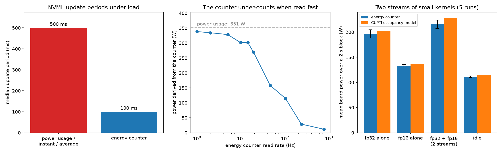

# nvml-energy-probes

How fast and how exactly NVML reports GPU power and energy, and whether CUPTI
kernel timestamps can split board power between kernels. The scripts check
what an energy profiler built on NVML can measure for a single kernel.



## What the runs show

- `nvmlDeviceGetPowerUsage` returns the average power field: the two values
  are identical. It takes about 1.5 s to follow a load step; the
  instantaneous field follows within one update.
- Under load the power values change every 500 ms and the energy counter
  every 100 ms. At idle the power values change every 500 ms or 1 s.
- The energy counter is within 5% of the power reading when read once or
  twice a second. It under-counts when read faster: by 14% at 10 Hz and by
  97% in a tight loop. The cause is not known.
- A model of idle power plus one term per kernel type, on the occupancy that
  CUPTI reports, is fitted on blocks that run one type at a time. On blocks
  where an fp32 and an fp16 matmul run on two streams without overlapping, it
  predicts the mean power within 1 W (265 W measured, 5 runs).
- When the two streams overlap for about a tenth of their busy time, the
  model over-predicts by about 13 W (228 W against 216 W): power does not add
  up when two kernels share the GPU. The runs differ from each other by about
  10 W.

## Run

You need an NVIDIA GPU and a torch build with CUDA.

```
pip install -r requirements.txt
python probe_periods.py --load        # 25 s
python step_response.py               # 25 s
python counter_poll_rate.py           # 1.5 min
python attribution_kinds.py           # 1 min
python attribution_streams.py         # 1 min, add --large for big kernels
```

`results/` holds the outputs behind the figure. `python summarize.py` prints
their means and standard deviations, and `python make_figure.py` redraws the
figure.

## Limits

One RTX 3080 Ti, one driver (610.88), Windows 11: nothing was run on Linux or
on a data center GPU. The machine was a desktop session, so idle includes the
display (about 110 W). An idle block that follows a loaded one draws 10 to
20 W more: the SM clock does not drop within its 2 s. The coefficient of each
kernel type depends on the size of the kernels and on the duty cycle, so the
fits are not a ranking of the types.
